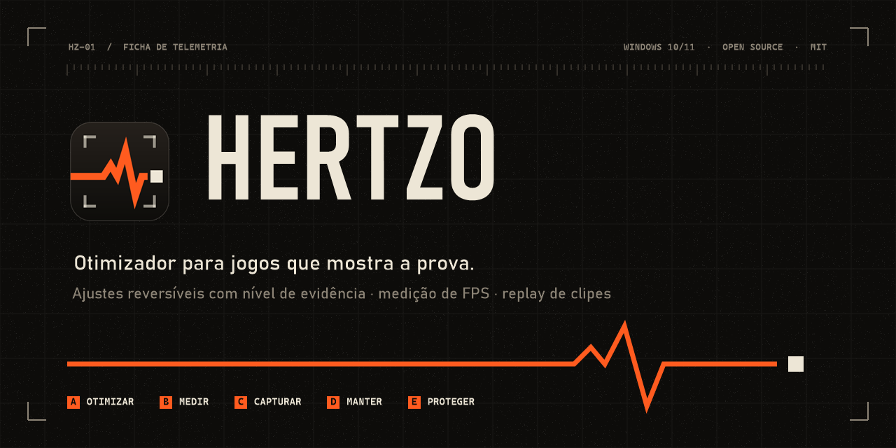
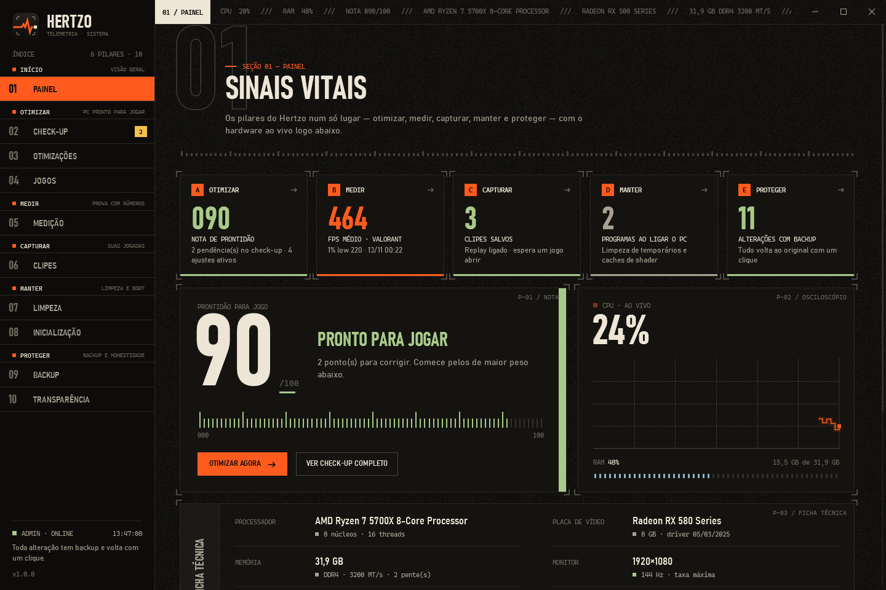
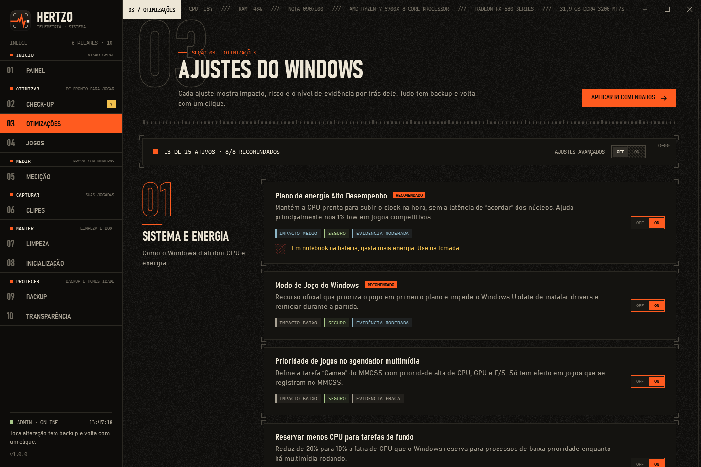
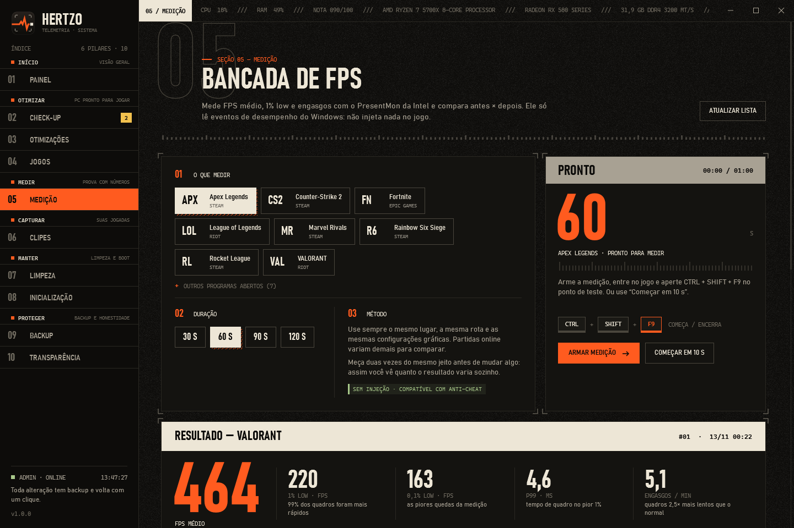
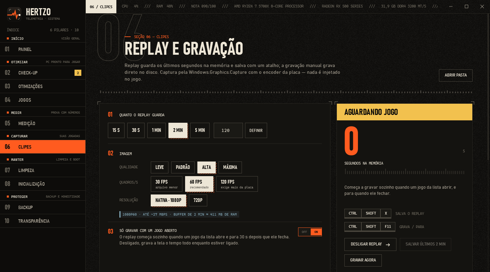
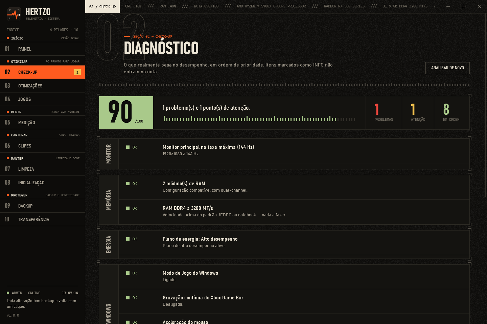
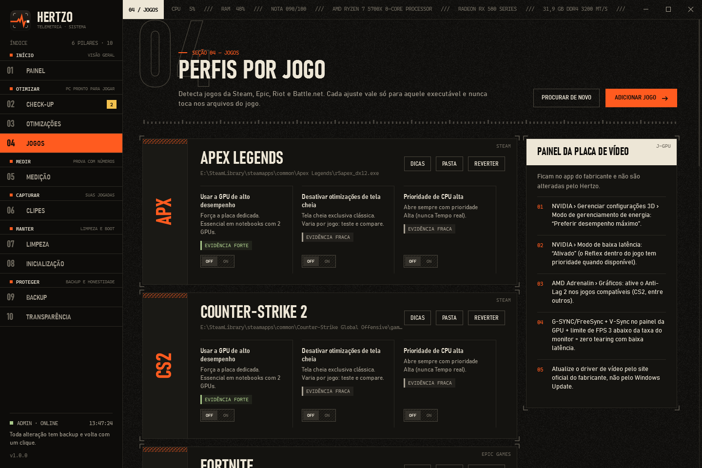
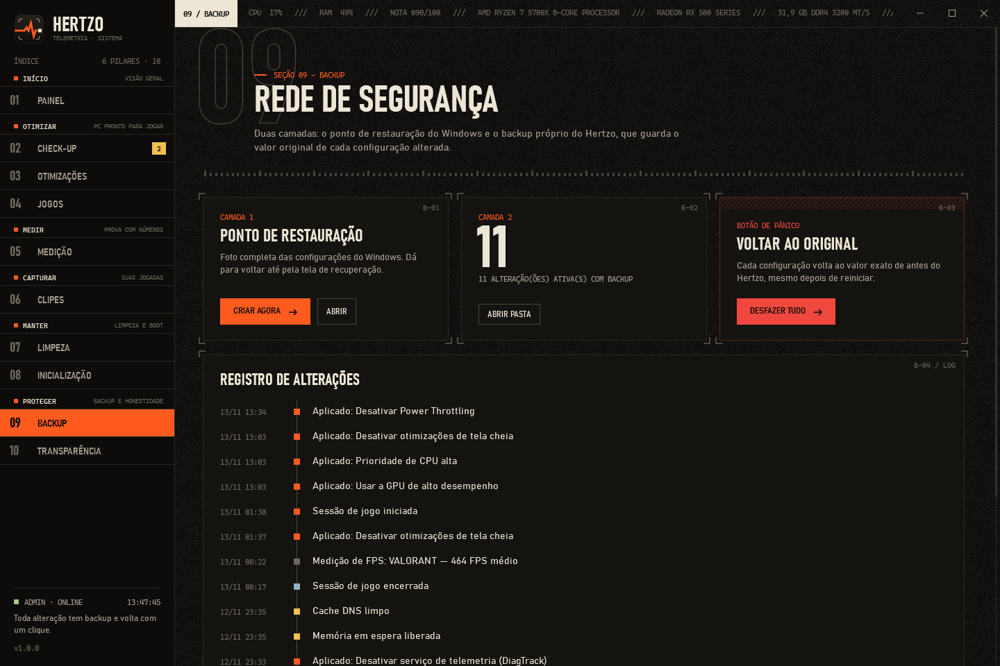
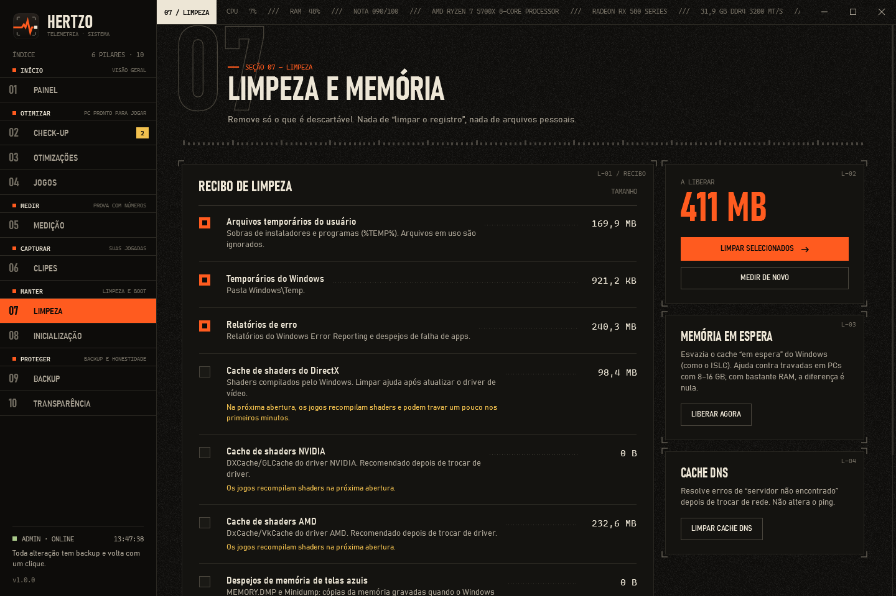
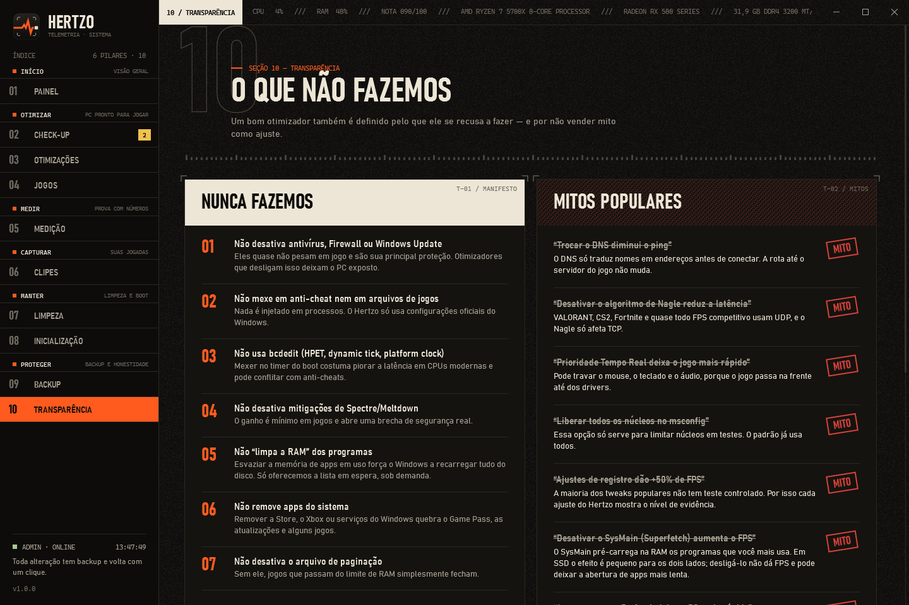

<p align="center">
  
</p>

<p align="center">
  <a href="https://github.com/ryan-hugo/hertzo/releases/latest"></a>
  
  
  <a href="LICENSE"></a>
  
</p>

<p align="center">
  <b><a href="https://ryan-hugo.github.io/hertzo/">Site</a></b> ·
  <b><a href="https://github.com/ryan-hugo/hertzo/releases/latest/download/Hertzo.exe">Download</a></b> ·
  <a href="#-recursos">Recursos</a> ·
  <a href="#-segurança">Segurança</a> ·
  <a href="#-perguntas-frequentes">FAQ</a> ·
  <a href="#-compilar">Compilar</a>
</p>

---

**Hertzo** é um otimizador para jogos no Windows que faz o contrário da maioria: **não promete FPS, mostra a prova**.
Cada ajuste vem com o impacto esperado, o risco e o **nível de evidência** por trás dele. Tudo tem backup e volta ao valor
original com um clique. E a tela **Medição** mede o FPS antes e depois, dizendo se a diferença é real ou só variação normal.

Ele também grava **clipes** (replay instantâneo e gravação manual) com o encoder de hardware da placa, sem injetar nada no jogo.

> Feito para quem joga competitivo (VALORANT, CS2, Fortnite, Apex, R6, LoL e outros), mas funciona com qualquer jogo.

<p align="center">
  
</p>

## ⚡ Por que o Hertzo

| Otimizadores comuns | Hertzo |
|---|---|
| “+50% de FPS” sem nenhuma medição | Mede FPS médio, 1% low e 0,1% low com o **PresentMon** da Intel e compara antes × depois |
| Aplicam dezenas de tweaks de fórum | 25 ajustes com rótulo de **evidência forte, moderada ou fraca**; os fracos nunca entram no “Otimizar agora” |
| Desligam Defender, Firewall e Windows Update | **Nunca** mexe em proteção, anti-cheat, `bcdedit` ou mitigações de CPU |
| Difícil (ou impossível) de desfazer | **Backup de cada valor original** + ponto de restauração + botão **Desfazer tudo** |
| Telemetria, anúncios, assinatura | **Open source (MIT)**, sem telemetria, sem conta, sem internet |

## 🧭 Recursos

O Hertzo é organizado em cinco pilares, como o menu do app.

### A · Otimizar
- **Check-up** com peso real. Começa pelo que mais custa caro: monitor rodando abaixo da taxa máxima (corrige com reversão automática em 15 s), RAM em canal único, XMP/EXPO provavelmente desligado, plano de energia, gravação em segundo plano do Game Bar, aceleração do mouse, driver de vídeo antigo, espaço em disco e VBS.
- **25 ajustes** em 6 categorias: sistema e energia, gráficos, mouse e teclado, segundo plano, rede e avançado. Os avançados ficam escondidos e pedem confirmação.
- **Perfis por jogo** com detecção de Steam, Epic, Riot, Battle.net e EA. Por executável: GPU de alto desempenho, desativar otimizações de tela cheia e prioridade Alta (nunca Tempo real).

### B · Medir
- **FPS médio, 1% low, 0,1% low, P99 e engasgos** por minuto, com gráfico de tempo de quadro.
- Leitura do resultado: modo de apresentação, VSync e limite por GPU ou por CPU.
- **Antes × depois:** lista os ajustes que mudaram entre as duas medições e marca como **RUÍDO** o que está dentro da variação normal (±3% no médio, ±6% no 1% low, ±10% no 0,1% low).
- Atalho **Ctrl + Shift + F9** dentro do jogo, com bipes de início e fim.

### C · Capturar
- **Replay instantâneo** de 5 s a 10 min guardado na RAM; nada vai para o disco até você salvar.
- **Gravação manual** direto no disco, sem limite de tempo.
- 30, 60 ou 120 FPS, resolução nativa, 1080p ou 720p (a redução é feita na GPU), H.264 no **encoder de hardware** (AMD AMF, NVIDIA NVENC, Intel QuickSync).
- **Áudio do jogo e do microfone** com volume ao vivo, medidores e uma faixa extra só com o microfone, para edição.
- **Aviso na tela do jogo** (“CLIPE SALVO · 30 S”, ● REC), sem roubar foco nem cliques. Atalhos configuráveis.

### D · Manter
- **Limpeza** do que é descartável: temporários, relatórios de erro, caches de shader (DirectX, NVIDIA, AMD), despejos de memória de telas azuis e Lixeira. Nada de “limpar o registro”.
- **Memória em espera** e **cache DNS** sob demanda.
- **Inicialização:** liga e desliga programas que abrem com o Windows, pelo mesmo mecanismo do Gerenciador de Tarefas. Anti-cheat, segurança e áudio ficam marcados.

### E · Proteger
- **Duas camadas:** ponto de restauração do Windows e o diário próprio do Hertzo, que guarda o valor exato de cada configuração alterada.
- **Desfazer tudo** em um clique, mesmo depois de reiniciar.
- **Transparência:** o que o Hertzo se recusa a fazer, mitos populares desmentidos e as fontes de cada ajuste.

## 🖼️ Telas

<table>
  <tr>
    <td width="50%"><br><sub><b>Otimizações</b> · cada ajuste com impacto, risco e evidência</sub></td>
    <td width="50%"><br><sub><b>Medição</b> · 464 FPS médio, 1% low 220 no VALORANT</sub></td>
  </tr>
  <tr>
    <td><br><sub><b>Clipes</b> · replay na RAM com encoder de hardware</sub></td>
    <td><br><sub><b>Check-up</b> · diagnóstico ordenado pelo que mais pesa</sub></td>
  </tr>
  <tr>
    <td><br><sub><b>Jogos</b> · ajustes por executável e dicas por jogo</sub></td>
    <td><br><sub><b>Backup</b> · histórico e Desfazer tudo</sub></td>
  </tr>
  <tr>
    <td><br><sub><b>Limpeza</b> · só o que é descartável</sub></td>
    <td><br><sub><b>Transparência</b> · o que o Hertzo nunca faz e por quê</sub></td>
  </tr>
</table>

## 📥 Instalação

1. Baixe o **[`Hertzo.exe`](https://github.com/ryan-hugo/hertzo/releases/latest/download/Hertzo.exe)** (versão mais recente; notas e SHA-256 na [página de releases](https://github.com/ryan-hugo/hertzo/releases/latest)). É um arquivo único, sem instalador e sem precisar instalar o .NET.
2. Abra. O Windows pede permissão de administrador, que é necessária para mexer em energia, serviços e registro do sistema.
3. Na primeira vez, o **SmartScreen** pode avisar que o app não é reconhecido (o executável não tem assinatura paga). Clique em **Mais informações › Executar assim mesmo**. Se preferir, confira o SHA-256 publicado na release ou [compile você mesmo](#-compilar).

**Requisitos:** Windows 10 21H2+ ou Windows 11, x64. Clipes precisam de uma placa com encoder H.264 (praticamente todas desde 2014).

### Primeiros passos
1. **Painel › Otimizar agora:** aplica só os ajustes seguros e com evidência moderada ou forte, criando antes um ponto de restauração.
2. **Medição:** meça o seu jogo antes e depois. Se a diferença for ruído, o Hertzo diz.
3. **Clipes › Ligar replay** e aperte **Ctrl + Shift + F10** depois de uma boa jogada.

## 🔒 Segurança

**O que o Hertzo nunca faz:** desativar antivírus, Firewall ou Windows Update; mexer em anti-cheat ou em arquivos de jogos; injetar código em processos; usar `bcdedit`; desligar mitigações de Spectre/Meltdown; remover apps do sistema; desligar o arquivo de paginação; acessar a internet.

**Backup por valor.** Antes de qualquer escrita, o valor original vai para `%ProgramData%\Hertzo\journal.json`. Reverter devolve o valor exato, ou apaga o valor se ele não existia antes.

**Rodar como administrador é tratado como responsabilidade** ([`Core/Security.cs`](Hertzo/Core/Security.cs)):
- `%ProgramData%\Hertzo` é **só dos administradores**. Programas sem admin não conseguem plantar ou trocar arquivos lá.
- O **diário é validado**: cada entrada só pode restaurar um valor que aquele ajuste realmente altera. Um `journal.json` adulterado não consegue escrever em `Run`, em `IFEO\…\Debugger` nem em nenhum outro lugar.
- O **PresentMon** embutido é conferido por SHA-256 e pelo dono do arquivo antes de cada uso.
- A **Limpeza resiste a junções**: o caminho real de cada arquivo é conferido no momento de apagar.
- **Nada abre como admin:** sites, pastas e clipes abrem pelo Explorer do usuário.

Encontrou uma falha? Veja o [SECURITY.md](SECURITY.md) para reportar em particular.

## ❓ Perguntas frequentes

<details>
<summary><b>Posso ser banido por usar o Hertzo?</b></summary>

O Hertzo não injeta nada nem lê a memória dos jogos. Ele só usa configurações oficiais do Windows. A medição usa os eventos de apresentação de quadros que o próprio Windows publica (ETW), via PresentMon; os clipes usam a Windows.Graphics.Capture, a mesma API do OBS. Funciona com Vanguard, VAC, EAC e BattlEye. Mesmo assim, nenhum programa de terceiros pode garantir isso por um anti-cheat.
</details>

<details>
<summary><b>Quanto FPS eu vou ganhar?</b></summary>

Depende do PC, e por isso o Hertzo mede em vez de prometer. Os ganhos grandes vêm de problemas reais que o Check-up encontra (monitor a 60 Hz em vez de 144, RAM sem XMP, plano Equilibrado). Em um PC já bem configurado, a diferença costuma ser pequena, e a Medição mostra isso.
</details>

<details>
<summary><b>Por que ele pede administrador?</b></summary>

Planos de energia, serviços, políticas do Windows e chaves em `HKLM` só podem ser alterados com admin. Veja em <a href="#-segurança">Segurança</a> como o Hertzo se protege por rodar assim.
</details>

<details>
<summary><b>Os clipes deixam o jogo mais lento?</b></summary>

A codificação roda no chip de vídeo dedicado da placa, não nos núcleos da GPU. No teste (RX 580, 1080p60) o processo usou 1–2% da CPU. Meça o seu caso: Medição com o replay ligado e desligado.
</details>

<details>
<summary><b>Como desinstalo?</b></summary>

Antes, use **Backup › Desfazer tudo**. Depois apague o `Hertzo.exe` e, se quiser, as pastas `%ProgramData%\Hertzo` e `%LocalAppData%\Hertzo`.
</details>

## 🛠️ Compilar

Requisitos: Windows 10/11 x64 e o [.NET 10 SDK](https://dotnet.microsoft.com/download).

```powershell
git clone https://github.com/ryan-hugo/hertzo.git
cd hertzo
.\build.ps1          # dist\Hertzo.exe autocontido (~67 MB)
.\build.ps1 -Small   # versão pequena, exige o .NET 10 Desktop Runtime
```

Para desenvolver: `dotnet build Hertzo\Hertzo.csproj` e `dotnet run --project Hertzo` (em um terminal como administrador).

<details>
<summary><b>Estrutura do código</b></summary>

```
Hertzo/
  Core/         lógica
    TweakCatalog  os 25 ajustes (registro, serviços, planos e configurações de energia)
    Tweaks        tipos de ajuste: detectar, aplicar com backup, reverter
    Journal       diário de backup por valor
    Security      proteções por rodar como admin
    Checkup       diagnóstico com peso
    Bench         medição de FPS (PresentMon) e estatísticas
    Replay        replay/gravação: captura, H.264 por hardware, MP4 fragmentado na RAM
    Capture       Windows.Graphics.Capture
    Audio         WASAPI (loopback + microfone) e mixer
  ViewModels/   estado das telas (MVVM sem dependências externas)
  Views/        10 telas em XAML
  Ui/           identidade visual (Theme.xaml), controles próprios e o aviso no jogo
  Assets/       ícone e PresentMon embutido
tools/          geradores do ícone e do banner; estatisticas.ps1 (downloads e visitas)
docs/           site (GitHub Pages) e imagens
```
</details>

<details>
<summary><b>Como o replay funciona por dentro</b></summary>

- **Captura:** Windows.Graphics.Capture com intervalo mínimo de atualização de 1 ms. No teste com Fortnite a ~140 FPS chegaram 141 quadros/s e o clipe teve **0% de quadros repetidos**. O Desktop Duplication fica só como reserva.
- **Codificação:** um único encoder H.264 contínuo via Media Foundation, gerando MP4 fragmentado na RAM. Ao salvar, os fragmentos são juntados sem recodificar, a partir do quadro-chave anterior.
- **Ritmo:** thread de captura com prioridade multimídia (MMCSS) e temporizador de 1 ms. As texturas vêm de um alocador que só as reaproveita depois que o encoder termina.
- **Áudio:** WASAPI (loopback da saída padrão + microfone) a 48 kHz, posicionado pelo mesmo relógio (QPC) do vídeo e codificado em AAC. Sincronia medida: 9–39 ms.
- **Limitações:** o som do jogo é o da saída inteira; grava só o monitor principal; em tela cheia exclusiva antiga o aviso pode não aparecer por cima do jogo (os bipes continuam).
</details>

## 🎨 Identidade visual

“Ficha de telemetria”: Estilo Tipográfico Internacional (grade modular, tipo gigante, fios finos), design industrial de instrumentos (uma cor de sinal, rótulos minúsculos, controles que parecem físicos) e textura tátil (grão de filme, hachuras, marcas de corte).
Preto quente `#0D0C0A`, osso `#EDE6D6` e um único laranja de sinal `#FF5B1F`. Bahnschrift condensada nos títulos e Cascadia Mono nos dados.

## 🤝 Contribuindo

Ajustes novos são bem-vindos **com fonte**. Leia o [CONTRIBUTING.md](CONTRIBUTING.md): todo ajuste precisa ser reversível e ter o nível de evidência declarado com honestidade.

## 📄 Licença

[MIT](LICENSE). Software de terceiros incluído:
- **PresentMon 2.6.0** — Copyright © 2017-2024 Intel Corporation, licença MIT ([licença](Hertzo/Assets/Tools/PresentMon-LICENSE.txt)). Embutido e conferido por SHA-256 (`b2a706bc…88f1af`).
- **Vortice.Windows 3.8.3** — Copyright © Amer Koleci e colaboradores, licença MIT.

<p align="center"><sub>Hertzo não é afiliado a Microsoft, Intel, NVIDIA, AMD, Riot Games, Valve, Epic Games ou qualquer outra empresa citada. Nomes de jogos e marcas pertencem aos seus donos.</sub></p>
